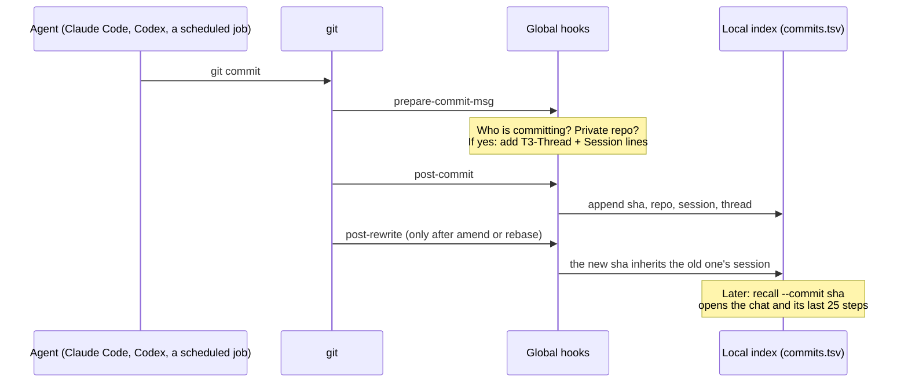

+++
title = "My git blame now tells me why"
date = 2026-10-12
draft = false
tags = ["Dev", "AI", "Git", "Agents", "Version Control"]
complexity = "medium"
description = "Every commit my AI agents make now links back to the chat that asked for it. Same idea as Zed's Delta and Cursor's Origin, built on plain git in four minutes. Here's how it works, with a playground."
+++

`git blame` tells you who changed a line. Mine now tells me why.

I [posted this on LinkedIn](https://www.linkedin.com/feed/update/urn:li:activity:7515324153051275264/) this week, and a few people asked how it actually works. So here's the long version: what it does, how it's built, and a machine you can play with to see it run.

## The problem: agents commit all day, and the reason vanishes

My agents commit code all day. My AI agent [Stewie](/blog/hi-im-stewie-isaacs-ai-agent/) alone runs a whole computer, and a handful of other agents work on my projects next to it. When something broke, the commit told me *what* changed. Never what I had asked for, or what the agent read before it decided.

That's not just annoying. It's dangerous. An agent that finds a weird-looking line and "fixes" it without knowing why it's there just brings back the bug that line was fixing. Faster than a human would.

Back in June I wrote that [git wasn't built for agents](/blog/git-wasnt-built-for-agents/). The short version: git saves the final code and throws away the conversation that produced it. Two big companies agreed and started building whole new systems to fix that. Zed built **DeltaDB**, which records every edit and the AI chat behind it. Cursor built **Origin**, a new GitHub-style code host for a world where agents write most of the code.

I wanted the same thing. But I didn't want to move my code anywhere. So on October 11 I asked Stewie one question in a chat: *what if every commit to a private repo had its chat attached?* I said "build it" at 13:03. At 13:07 the first commit with a chat link landed. (I know the exact minutes because the commit links back to that chat.)

## Play with it first

This is the whole system as a little machine. Every commit is a card. The card rides past a stamp, and the stamp prints two lines onto it: which chat and which agent session made it. Then a copy of every card goes into a card box on my machine. When something breaks, `recall --commit` pulls the card out of the box and opens the chat.

Pick who commits and where, press **git commit**, and watch what gets printed. Try a public repo, then try "You, in a terminal". The two cards already in the box are real commits from my machine, so you can click one in the index straight away.

<div class="cs-embed">
<iframe id="commit-stamp" src="../../playground/commit-stamp/" title="Interactive playground: the commit stamp. Commit as an agent, a scheduled job or a human into a private or public repo and watch the git hooks link the commit to its chat." loading="lazy" style="display:block;width:100%;height:1180px;border:0;background:transparent" scrolling="no"></iframe>
</div>
<script>
(function () {
  var f = document.getElementById('commit-stamp');
  function fit() { try { var b = f.contentDocument && f.contentDocument.body; if (b) f.style.height = Math.ceil(b.scrollHeight) + 'px'; } catch (e) {} }
  f.addEventListener('load', function () {
    fit();
    try { new ResizeObserver(fit).observe(f.contentDocument.body); } catch (e) {}
  });
})();
</script>

<noscript>The playground needs JavaScript. The rest of this post explains the same thing in words.</noscript>

## How it works

The whole thing is about 170 lines: one small Bash file and one Python script, plus a new option for `recall`, the search tool that already indexes every conversation my agents have ever had. Here's the path a commit takes.



### 1. One set of hooks for every repo

Git has [hooks](https://git-scm.com/docs/githooks): little scripts it runs at certain moments, like right before it writes a commit message. Normally each repo has its own. But git also lets you point *every* repo at one shared folder:

```sh
git config --global core.hooksPath ~/house/githooks
```

In that folder, every hook name is a link to one small dispatcher. It calls my script for the three moments I care about, then runs the repo's own hook if it has one. That second part matters: `core.hooksPath` would otherwise silently switch off every project's own hooks (linters, formatters), and I'd find out the hard way.

### 2. Who is committing?

The agents tell on themselves. Claude Code puts its session ID in an environment variable (`CLAUDE_CODE_SESSION_ID`), Codex does the same with `CODEX_THREAD_ID`, and my scheduled jobs set `AUTO_NAME`. Git passes those through to the hook. If none of them is set, a human is typing, and the hook does nothing.

For the chat itself, the script looks the session up in [T3 Code](https://t3.codes)'s database (read-only), which is the app I use to talk to my agents from my phone. That turns "session ee152e9c" into "the chat called *Link Commits to T3 Threads*".

### 3. The stamp: `prepare-commit-msg`

Right before git saves the message, the hook adds two [trailer lines](https://git-scm.com/docs/git-interpret-trailers) at the bottom, the same format as `Signed-off-by:`:

```text
Commit -> session links: global git hooks, commit-session, recall --commit

T3-Thread: 555685fb-25bf-49a4-b19a-0813b6cbe251
Session: claude:ee152e9c-d0d6-414a-868b-c5b38c81c5d9
```

It only does that when three things are true:

- **An agent is committing.** Humans get nothing.
- **The repo is private on GitHub.** It asks GitHub once and remembers the answer for a day. Public repos and my work GitLab stay clean, because those IDs mean nothing to anyone else and only leak how I work.
- **The message doesn't already have one.** When an agent amends or cherry-picks a commit, the original link stays.

### 4. The card box: `post-commit`

After *every* commit, in *every* repo, public or private, one line goes into a file on my machine: time, commit, repo, session, chat. This is the part that never leaves the box. It's why a commit to a public repo is still traceable for me, even though the commit itself is clean.

### 5. Amend and rebase: `post-rewrite`

`git commit --amend` and `git rebase` create *new* commits with new IDs, and the old IDs disappear. Git tells the `post-rewrite` hook "old ID → new ID", so the new commit inherits the old one's session. Without this, every rebase would quietly cut the link.

### 6. Reading it back: `recall --commit`

When something breaks: `git log` or `git blame` to find the commit, then

```sh
recall --commit ab6fec8
```

It finds the commit in the local index (or reads the trailer lines, if the commit came from somewhere else), opens the chat, and prints my request and the agent's last 25 steps before that commit: which files it read, what it ran, what it concluded. For a scheduled job it points at the job's logs instead.

### 7. The rule that makes it matter

Building the link was half of it. Then I asked: do the other agents know? Now their shared notes say: *something broke or changed unexpectedly? Find the commit, run `recall --commit`, and read why it was done before you change it back.*

One more design rule: the hook can never break a commit. Every error is swallowed, and the whole thing adds about half a second.

## The same idea as DeltaDB and Origin, at a much smaller size

This is really the same idea Zed and Cursor are chasing: **the conversation is part of the source.** Since my June post, both shipped. Zed opened [Delta](https://zed.dev/blog/introducing-delta), the first app built on DeltaDB, in August and put it in [public beta](https://zed.dev/blog/delta-public-beta) on September 16. Cursor started the [Origin early beta](https://forum.cursor.com/t/origin-code-hosting/168670) on August 17.

The difference is how much each one stores.

| | My hook | Zed Delta (DeltaDB) | Cursor Origin |
| --- | --- | --- | --- |
| What gets saved | A pointer from each commit to its chat | Every edit between commits, plus the chat, synced live | Your repos and pull requests, hosted next to Cursor's agents |
| Smallest step you can go back to | A commit | A single edit | A commit or pull request |
| Where the chat lives | On my machine | In DeltaDB, shared with your team | In Cursor |
| Can a teammate open it? | No, the link only works on my machine | Yes, they can join the chat live | Yes, inside Cursor |
| What you change | Nothing. Plain git, plain GitHub | Your workflow moves into Delta (git still works underneath) | Your code host (or a synced copy of GitHub) |
| Status (October 2026) | Running since October 11 | Public beta, free during the beta | Early beta, paid plans only |

My version is the cheapest one that works: it doesn't save the conversation at all, it just *points* at where it already is. DeltaDB is the full version. It saves every keystroke and the chat together, so you can scroll back through the work between commits, not just to the commits. Origin attacks it from the other end, by rebuilding the website where code gets reviewed.

What my pointer can't do:

- **It only goes as fine as a commit.** If an agent made five changes before committing, I see the conversation, not which message produced which line. DeltaDB ties each edit to its message.
- **It only works on my machine.** Session IDs are just labels. Anyone else who reads the commit sees two meaningless lines.
- **Delete the chat, lose the why.** The link is only as good as the transcript it points at.
- **It does nothing for merge conflicts.** Three agents editing the same file still fight like they always did.

For one person with a lot of agents, that trade is worth it. It took four minutes, costs nothing, and works with every repo I already have. For a team that wants to review agent work together, Delta or Origin is the real thing.

## Build your own in five lines

You don't need my setup to get most of the value. If you use Claude Code, save this as `.git/hooks/prepare-commit-msg` in a repo (or in a global hooks folder) and make it executable:

```sh
#!/bin/sh
# Stamp the Claude Code session into every commit it makes.
[ -n "$CLAUDE_CODE_SESSION_ID" ] || exit 0          # a human is committing
[ "$2" = merge ] && exit 0                          # leave merge commits alone
grep -q '^Session: ' "$1" && exit 0                 # amend: keep the original
git interpret-trailers --in-place --trailer "Session: claude:$CLAUDE_CODE_SESSION_ID" "$1"
```

The full conversation is already on your disk: Claude Code keeps every session as a file named after the session ID under `~/.claude/projects/`, and Codex keeps its own under `~/.codex/sessions/`. So when something breaks:

```sh
git log -1 --format='%(trailers:key=Session,valueonly)' <sha>
```

gives you the ID, and the file with that name is the "why". Add the public-repo check before you use it anywhere public.

## The honest caveat

This isn't version control for agents. It's a sticky note on a commit that says where to look. It's useful because it costs nothing and needs no new tools. But it doesn't save the work between commits, and it doesn't help a team.

Still, the diagnosis from June holds, and now I feel it every day: the code is the easy part to keep. The *why* is what goes missing. Delta keeps all of it, Origin builds a new home for it, and on my machine two lines at the bottom of each commit do just enough.

## Commit-to-chat FAQ


What is a git trailer? || A "Key: value" line at the very end of a commit message, like Signed-off-by. Git has tools to add and read them, so they're a clean place for extra facts about a commit.
Does this work with any AI coding agent? || Yes, if the agent puts its session ID somewhere the hook can read it. Claude Code and Codex set environment variables. For anything else you can set your own variable before the agent starts.
Why not add the trailers to public repos too? || The IDs only work on my machine, so to everyone else they're noise. And they'd leak how I work. The local index still records public commits, so I can trace them anyway.
What does recall --commit show? || The chat that made the commit, my request, and the agent's last 25 steps before the commit: files it read, commands it ran, and what it concluded.
How is this different from Zed's Delta? || Delta saves every edit and the conversation together, live, for a whole team. My hook only stores a pointer from each commit to a chat that already exists on my machine.

